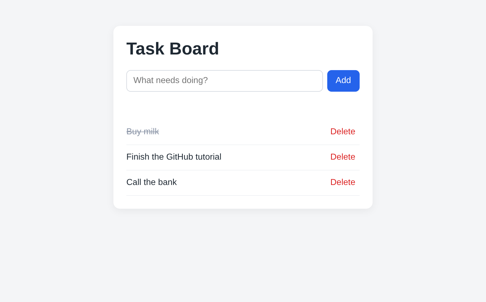

# Task Board

A tiny to-do app built to show **how a typical GitHub repo is organised**:
which code is frontend, which is backend, and how the pieces talk to each other.



## Run it

You need [Node.js](https://nodejs.org) (version 18 or newer).

```bash
cd backend
npm install     # downloads Express into backend/node_modules
npm start       # starts the server
```

Then open http://localhost:3000 in your browser.

## Folder map

```
Testing/
├── README.md              <- this guide (GitHub shows it on the repo home page)
├── .gitignore             <- files Git should NOT track (node_modules, runtime data)
│
├── frontend/              <- FRONTEND: runs in the user's browser
│   ├── index.html         <- structure: what is on the page
│   ├── style.css          <- looks: colors, spacing, fonts
│   └── app.js             <- behaviour: button clicks, calls the backend API
│
└── backend/               <- BACKEND: runs on the server (Node.js)
    ├── package.json       <- project info + list of libraries (dependencies)
    └── src/
        ├── server.js      <- entry point: starts the server, wires everything up
        ├── routes/
        │   └── tasks.js   <- URL map: which URL goes to which function
        ├── controllers/
        │   └── tasksController.js  <- logic: validate input, decide the response
        └── data/
            └── store.js   <- storage: reads/writes tasks (a JSON file here)
```

## How a click travels through the code

Example: you type "Buy milk" and press **Add**.

1. **frontend/app.js** catches the form submit and sends
   `POST /api/tasks` with `{ "title": "Buy milk" }`.
2. **backend/src/server.js** receives it and hands any `/api/tasks` URL to the routes.
3. **backend/src/routes/tasks.js** sees `POST /` and calls `createTask`.
4. **backend/src/controllers/tasksController.js** checks the title is not empty,
   then asks the data layer to save it.
5. **backend/src/data/store.js** writes the task into `tasks.json`.
6. The controller replies with the new task; **app.js** reloads the list
   and the page updates.

```
Browser (frontend)  --HTTP-->  server.js  ->  routes  ->  controller  ->  store
        ^                                                                  |
        +-------------------------- JSON response <------------------------+
```

## API reference

| Method | URL              | What it does            |
|--------|------------------|-------------------------|
| GET    | /api/tasks       | List all tasks          |
| POST   | /api/tasks       | Create a task `{title}` |
| PATCH  | /api/tasks/:id   | Toggle done / not done  |
| DELETE | /api/tasks/:id   | Delete a task           |

## Why split it like this?

Each layer has one job, so a change usually touches one place:

- Want a new color? Only `style.css`.
- Want a new API endpoint? Add a route + a controller function.
- Want a real database instead of a JSON file? Only `store.js` changes.

## Git basics to try on this repo

```bash
git checkout -b my-change     # make a branch to experiment safely
# ...edit a file, e.g. change the title in frontend/index.html...
git status                    # see what changed
git add .                     # stage the changes
git commit -m "Change title"  # save a snapshot
git push -u origin my-change  # upload the branch to GitHub
```

Then open a **Pull Request** on GitHub to propose merging your branch into `main`.
